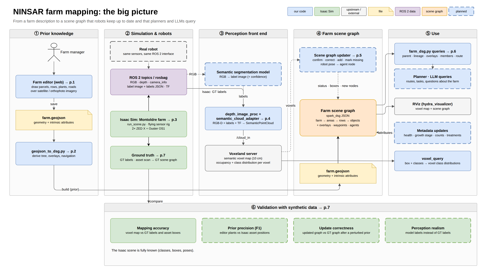
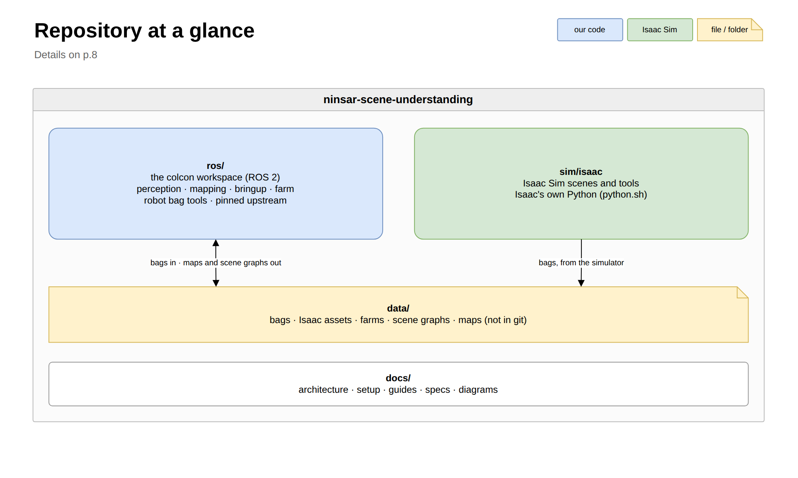

# Architecture

From a farm description to a scene graph that robots keep up to date and that planners query.

1. **Prior knowledge.** A farm manager draws the farm (parcels, rows, plants, roads) in the farm
   editor over satellite or orthophoto imagery. The editor saves a farm GeoJSON, and
   `geojson_to_dsg` derives the farm scene graph from it: tree, overlays, navigation.
2. **Simulation and robots.** Isaac Sim flies a sensor rig (2× ZED X + Ouster OS1) over a
   simulated farm and publishes the same ROS 2 interface a real robot has: RGB, depth,
   camera_info, a label image with its labels JSON, and TF. Recordings go to `data/bags/`.
3. **Perception front end.** `semantic_cloud_adapter` turns depth and labels into the semantic
   cloud `cloud_in`. The Voxeland server integrates it into a semantic voxel map, and
   `object_detector` turns each frame into 3D objects. In simulation the labels are ground
   truth; on robots they'll come from a segmentation model.
4. **Farm scene graph.** A spark_dsg graph: farm → areas → rows → objects, plus overlays,
   waypoints and agents. Updating it from perception (confirm, correct, add, mark missing) is
   planned.
5. **Use.** Queries on the graph (`farm_dsg`), map queries (`voxel_query`), RViz, and later
   planners and LLM queries.
6. **Validation.** The Isaac scene is fully known, so mapping, the prior and the updates can be
   checked against ground truth.

## Where each part lives

| part | package / folder |
|---|---|
| farm editor, GeoJSON, scene graph builders and queries | `ros/src/ninsar_farm` |
| `semantic_cloud_adapter`, `object_detector` | `ros/src/ninsar_perception` |
| Voxeland config, `voxel_query`, `tf_to_pose_cov` | `ros/src/ninsar_mapping` |
| system launch files, rviz, per-scenario configs | `ros/src/ninsar_bringup` |
| robot bag repair, lidar calibration, TF tuning | `ros/src/ninsar_bag_fix`, `ninsar_lidar_calib`, `ninsar_tf_tools` |
| Voxeland, Hydra, spark_dsg and their dependencies | `ros/src/upstream` (pinned in `ros/upstream.repos`) |
| Isaac Sim scenes and tools | `sim/isaac` (assets through `sim/isaac/assets` → `data/assets`) |
| bags, assets, farms, scene graphs, maps | `data/` |

## Isaac Sim and ROS

Isaac Sim and the ROS workspace run under different Pythons and share no code. They meet in
three places, and a change on one side has to keep these working:

| interface | Isaac side (`sim/isaac`) | ROS side (`ros/`) |
|---|---|---|
| **Bag topics** | `run_scene.py` publishes, `ros2 bag record` writes to `data/bags/isaac/` | `ninsar_bringup` `isaac_voxeland.launch` reads `/clock`, `/tf`, `/tf_static` and `/sensor_rig/front_camera/{rgb, depth, camera_info, semantic_segmentation, semantic_labels}` |
| **Frames** | world prim → `base_link` → `sensor_rig` → `zed_x_front` → `front_left_camera_optical_link` (frame names are prim names) | the adapter's `output_frame` (`zed_x_front`) and the scene graph's `frame_id: world` |
| **Labels** | semantic class names on the prims; `semantic_labels` JSON maps image ids to names per frame | `config/isaac/semantic_cloud_adapter.yaml` `categories` (by name; ids are only a fallback) |
| **Assets list** | `tools/scan_isaac_assets.py` writes `ros/src/ninsar_farm/config/isaac_assets.json` | `ros2 run ninsar_farm make_isaac_farm_dsg` builds the ground-truth scene graph from it |

## Interfaces

The specs are the contracts between these parts:

- [CLOUD_IN_SPEC.md](specs/CLOUD_IN_SPEC.md): the semantic cloud from the adapter to the
  Voxeland server and the detector.
- [OBJECT_DETECTOR.md](specs/OBJECT_DETECTOR.md): the detector's output.
- [FARM_GEOJSON_SPEC.md](specs/FARM_GEOJSON_SPEC.md): the farm description the editor writes.
- [FARM_DSG_SPEC.md](specs/FARM_DSG_SPEC.md): the farm scene graph.

## Diagram pages

Every page of [diagrams/ninsar_overview.drawio](diagrams/ninsar_overview.drawio), exported:

| page | |
|---|---|
| [0 Big picture](diagrams/png/0_big_picture.png) | the whole system (above) |
| [1 Farm editor](diagrams/png/1_farm_editor.png) | drawing the farm prior |
| [2 GeoJSON → DSG](diagrams/png/2_geojson_dsg.png) | building the scene graph from the prior |
| [3 Isaac Sim](diagrams/png/3_isaac_sim.png) | the simulated sensor rig and scene |
| [4 Perception front end](diagrams/png/4_perception_front_end.png) | depth + labels → `cloud_in` → map and objects |
| [5 DSG update (planned)](diagrams/png/5_dsg_update_planned.png) | keeping the graph up to date from perception |
| [6 Query & metadata](diagrams/png/6_query_metadata.png) | querying the graph and attaching metadata |
| [7 Validation](diagrams/png/7_validation.png) | checks against Isaac ground truth |
| [8 Repositories](diagrams/png/8_repositories.png) | this repo's layout in detail |
| [9 Repositories (simple)](diagrams/png/9_repositories_simple.png) | the same at a glance |
